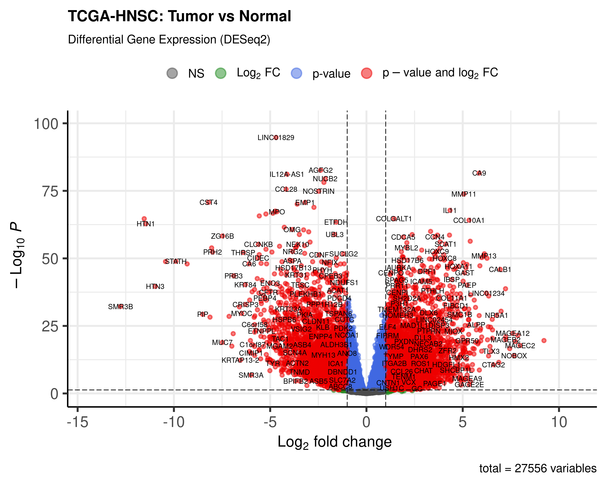
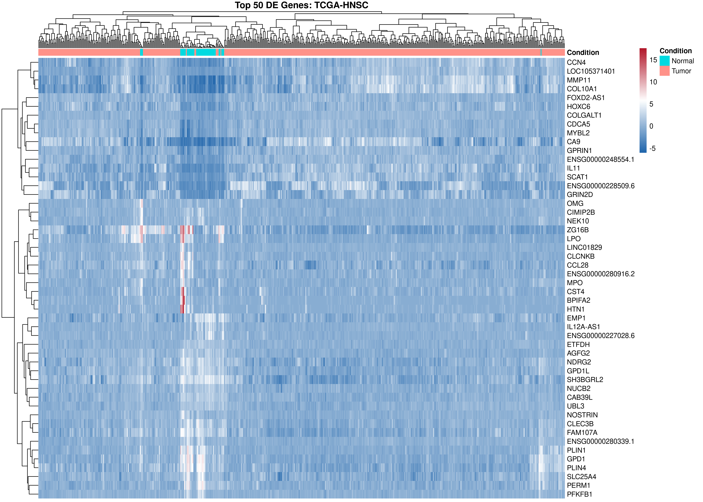
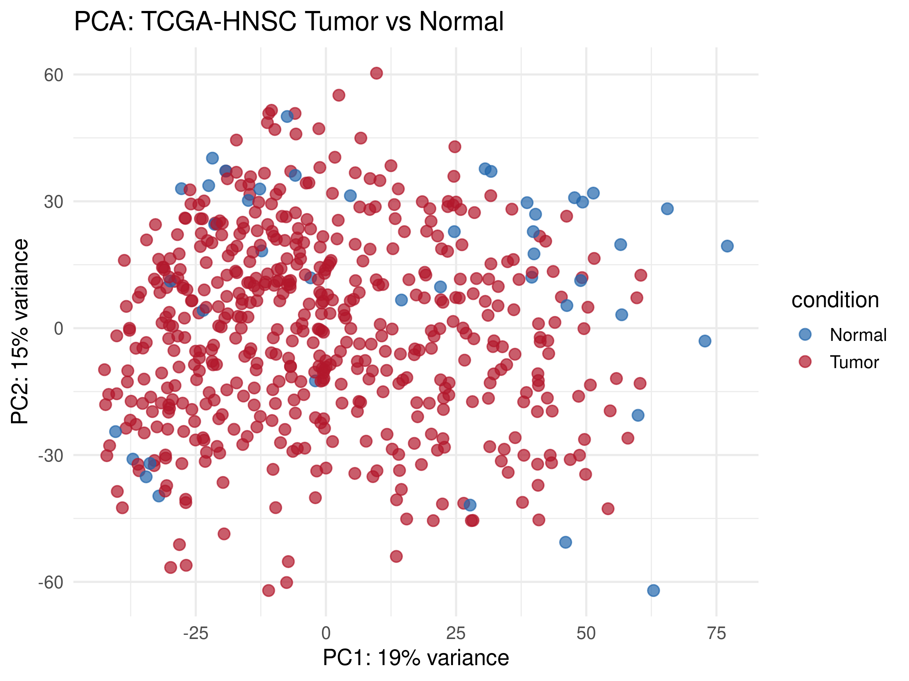
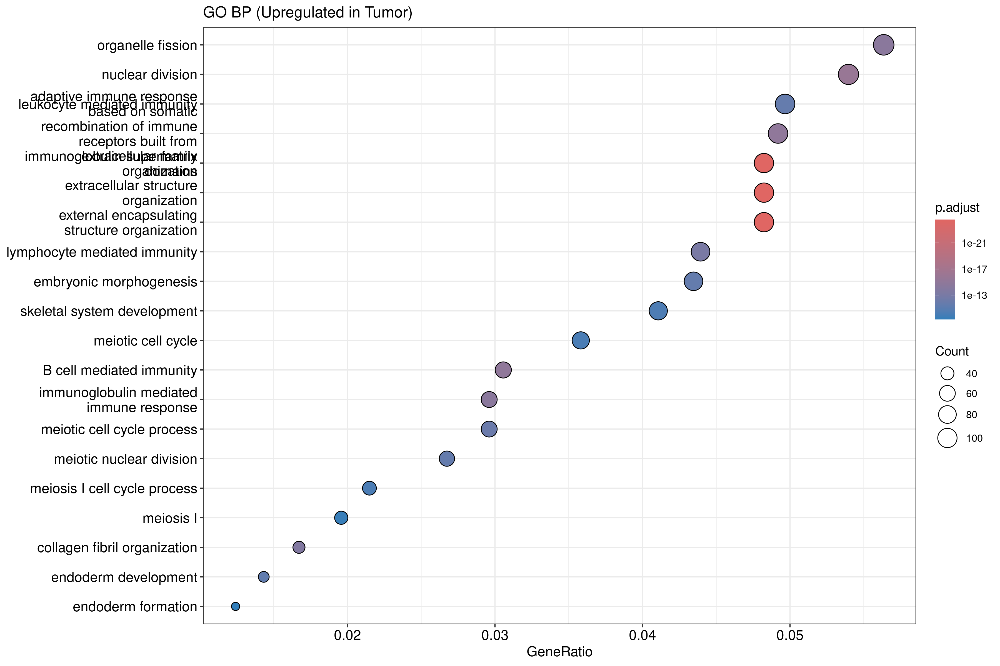
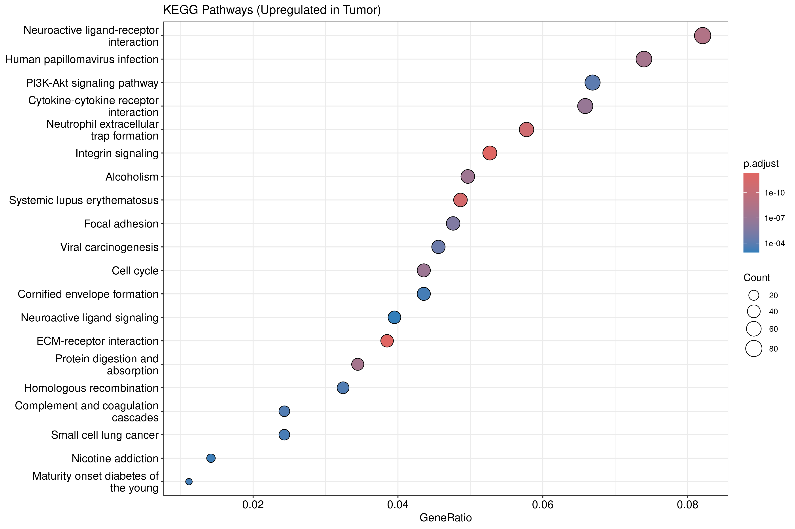
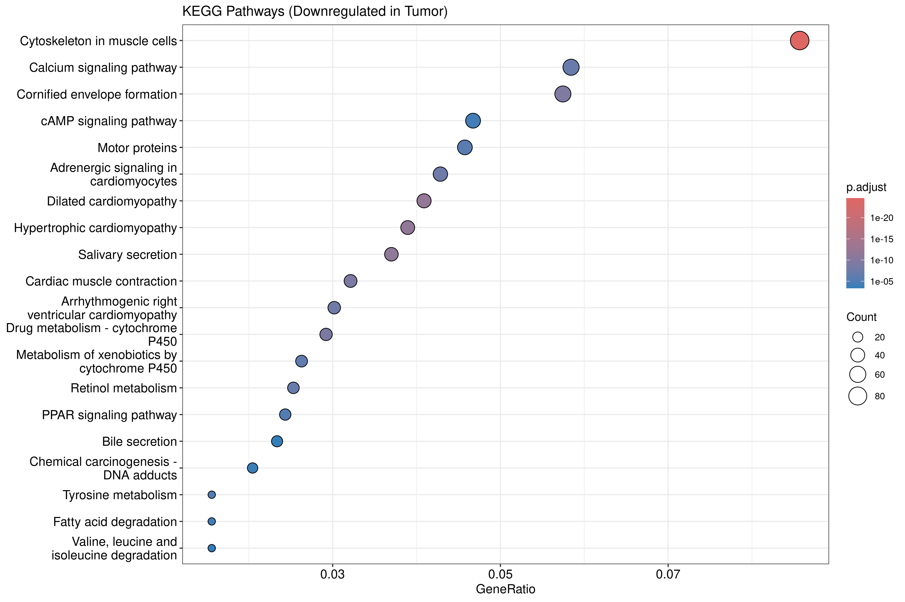
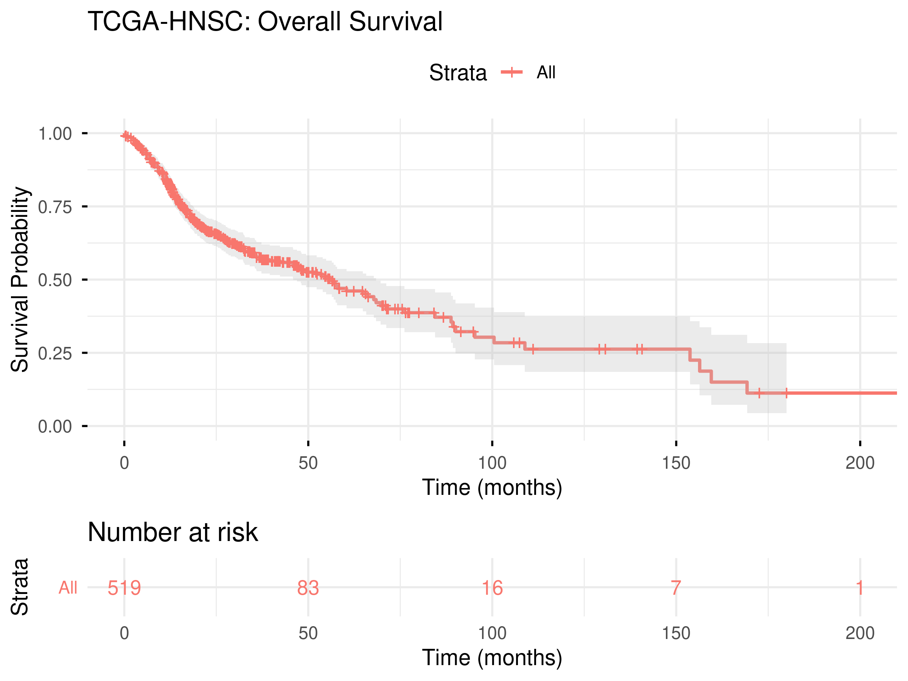
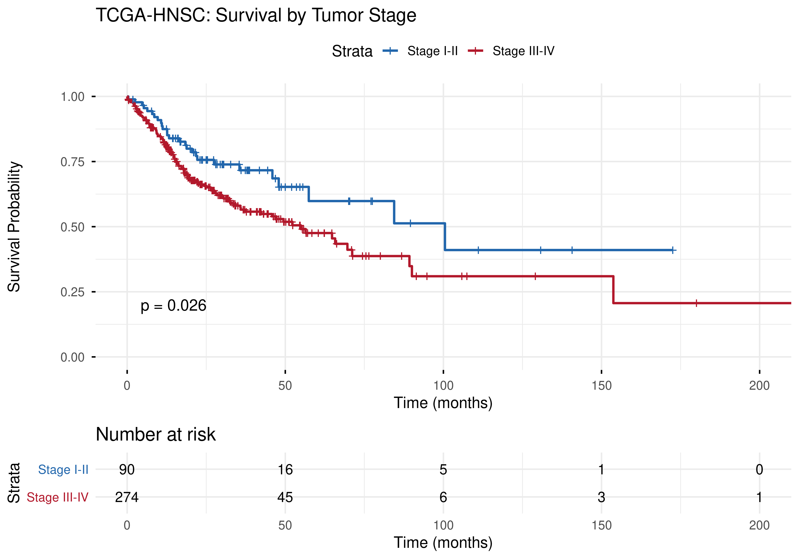
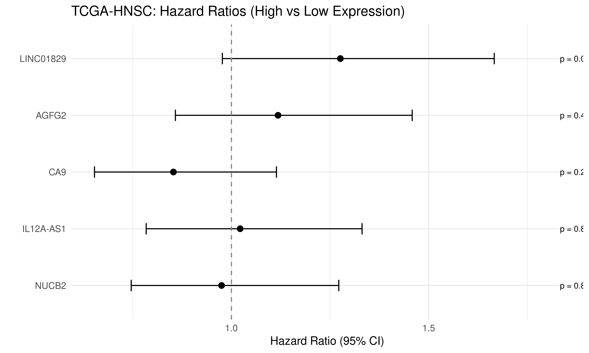

cat > ~/tcga-hnsc-pipeline/README.md << 'ENDOFFILE'
# TCGA-HNSC RNA-seq Differential Expression Pipeline

A complete bioinformatics pipeline for differential gene expression analysis of **Head and Neck Squamous Cell Carcinoma (HNSC)** using TCGA RNA-seq data. This project integrates DESeq2 differential expression, GO/KEGG pathway enrichment, survival analysis, and an interactive Shiny dashboard — built with reproducibility in mind using Nextflow and Docker.

> **Author:** Sohel Ahmed, Ph.D.  
> **Date:** October 2026

---

## Table of Contents

- [Overview](#overview)
- [Dataset](#dataset)
- [Pipeline Architecture](#pipeline-architecture)
- [Key Results](#key-results)
  - [Differential Expression](#differential-expression)
  - [GO Enrichment](#go-enrichment)
  - [KEGG Pathway Analysis](#kegg-pathway-analysis)
  - [Survival Analysis](#survival-analysis)
- [Interactive Shiny Dashboard](#interactive-shiny-dashboard)
- [Quick Start](#quick-start)
- [Project Structure](#project-structure)
- [Technologies](#technologies)

---

## Overview

This pipeline performs end-to-end RNA-seq analysis starting from TCGA data download through publication-quality visualizations and clinical outcome modeling. It demonstrates proficiency in:

- **Genomic data processing** — TCGA data retrieval via TCGAbiolinks, count matrix filtering, normalization
- **Statistical genomics** — DESeq2 differential expression with variance-stabilizing transformation
- **Functional enrichment** — Gene Ontology (Biological Process) and KEGG pathway analysis using clusterProfiler
- **Clinical integration** — Kaplan-Meier survival curves, Cox proportional hazards regression linking gene expression to patient outcomes
- **Pipeline engineering** — Nextflow DSL2 workflow with Docker/Singularity/HPC profiles
- **Interactive reporting** — Shiny dashboard with plotly for real-time data exploration

---

## Dataset

| Attribute | Value |
|-----------|-------|
| **Source** | [TCGA-HNSC](https://portal.gdc.cancer.gov/projects/TCGA-HNSC) |
| **Data type** | RNA-seq (STAR - Counts) |
| **Total samples** | 566 (520 Primary Tumor, 44 Solid Tissue Normal) |
| **Genes profiled** | 60,660 (pre-filter) |
| **Genes retained** | ~25,000 (after low-expression filtering) |

---

## Pipeline Architecture
``` text
TCGAbiolinks Download
│
▼
DESeq2 Analysis ──────────────────────┐
(Tumor vs Normal) │
│ │
├──▶ Volcano Plot │
├──▶ Heatmap (Top 50 DE genes) │
├──▶ PCA Plot │
│ │
▼ ▼
GO Enrichment KEGG Pathway Analysis
(Up & Downregulated) (Up & Downregulated)
│ │
└───────────┬───────────────────┘
│
▼
Survival Analysis
(KM curves, Cox regression)
│
▼
Shiny Interactive Dashboard
```

---

## Key Results

### Differential Expression

DESeq2 identified **4,941 upregulated** and **3,083 downregulated** genes (padj < 0.05, |log2FC| > 1).

**Volcano Plot** — Global view of differential expression between tumor and normal tissue:



**Heatmap** — Top 50 most significantly differentially expressed genes with clear separation between tumor and normal samples:



**PCA** — Principal component analysis showing distinct clustering of tumor vs. normal samples:



---

### GO Enrichment

Gene Ontology analysis reveals biological processes disrupted in HNSC:

**Upregulated in Tumor** — Enriched for extracellular matrix organization, cell adhesion, and immune response pathways:



---

### KEGG Pathway Analysis

KEGG pathway enrichment identifies specific signaling and metabolic pathways:

- **Top upregulated pathway:** ECM-receptor interaction (p = 5.1 × 10⁻¹³)
- **Top downregulated pathway:** Cytoskeleton in muscle cells (p = 2.5 × 10⁻²⁵)

**Upregulated pathways:**



**Downregulated pathways:**



---

### Survival Analysis

Clinical outcome analysis using TCGA survival data (n = 519 patients):

**Overall Survival** — Kaplan-Meier curve for the full HNSC cohort:



**Survival by Stage** — Stage III–IV patients show significantly worse prognosis compared to Stage I–II:



**Cox Regression** — Forest plot of hazard ratios for top differentially expressed genes:



---

## Interactive Shiny Dashboard

The Shiny app provides real-time exploration of the analysis results:

- **Interactive volcano plot** with adjustable significance and fold-change thresholds
- **Gene search** with expression boxplots and density curves
- **Heatmap and PCA** with customizable parameters
- **GO enrichment browser** with downloadable results

```bash
# Launch locally
cd shiny
Rscript -e "shiny::runApp('.', port = 3838)"
```

---

## Quick Start

### Option 1: Run directly with R

```bash
# Main analysis (downloads data on first run, caches for subsequent runs)
Rscript run_analysis.R

# KEGG pathway enrichment
Rscript kegg_analysis.R

# Survival analysis
Rscript survival_analysis.R
```

### Option 2: Run with Nextflow + Docker

```bash
nextflow run main.nf -profile docker
```

### Option 3: Run on HPC (SLURM)

```bash
nextflow run main.nf -profile hpc
```

---

## Project Structure

```text
tcga-hnsc-pipeline/
├── run_analysis.R # Main DESeq2 + GO enrichment pipeline
├── kegg_analysis.R # KEGG pathway enrichment analysis
├── survival_analysis.R # Kaplan-Meier + Cox regression
├── main.nf # Nextflow DSL2 pipeline
├── nextflow.config # Profiles: local, docker, singularity, HPC
├── Dockerfile # Reproducible container (rocker/r-ver:4.6.1)
├── shiny/
│ └── app.R # Interactive Shiny dashboard
├── images/ # Publication-quality figures
│ ├── volcano_plot.png
│ ├── heatmap_top50.png
│ ├── pca_plot.png
│ ├── go_dotplot_up.png
│ ├── kegg_dotplot_up.png
│ ├── kegg_dotplot_down.png
│ ├── km_overall.png
│ ├── km_by_stage.png
│ └── forest_plot_hr.png
└── results/ # Generated outputs (gitignored)
├── data/ # Cached TCGA data
├── deseq2/ # DESeq2 results and objects
├── enrichment/ # GO and KEGG enrichment tables
├── figures/ # All generated plots
└── survival/ # Survival analysis outputs
```
``` text

---

## Technologies

| Category | Tools |
|----------|-------|
| **Languages** | R 4.6.1 |
| **Differential Expression** | DESeq2, SummarizedExperiment |
| **Data Access** | TCGAbiolinks (GDC API) |
| **Enrichment** | clusterProfiler, org.Hs.eg.db |
| **Survival** | survival, survminer |
| **Visualization** | EnhancedVolcano, pheatmap, ggplot2, plotly |
| **Interactive** | Shiny, DT |
| **Pipeline** | Nextflow DSL2 |
| **Containers** | Docker (rocker/r-ver:4.6.1) |
| **Annotation** | org.Hs.eg.db (Bioconductor) |
ENDOFFILE
```
